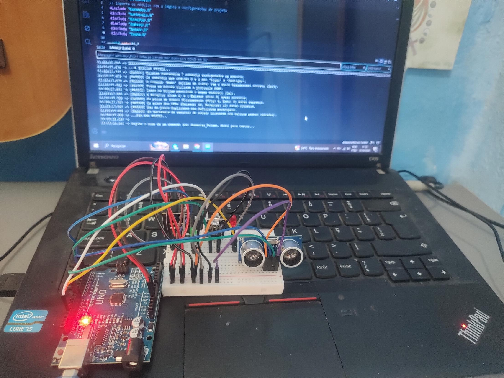
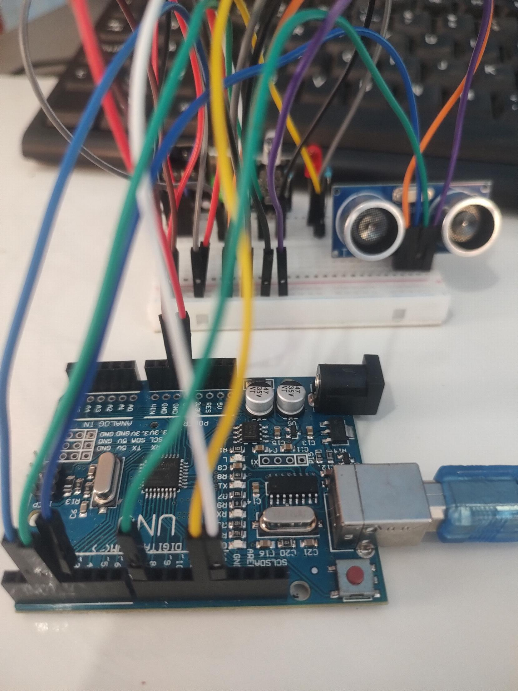
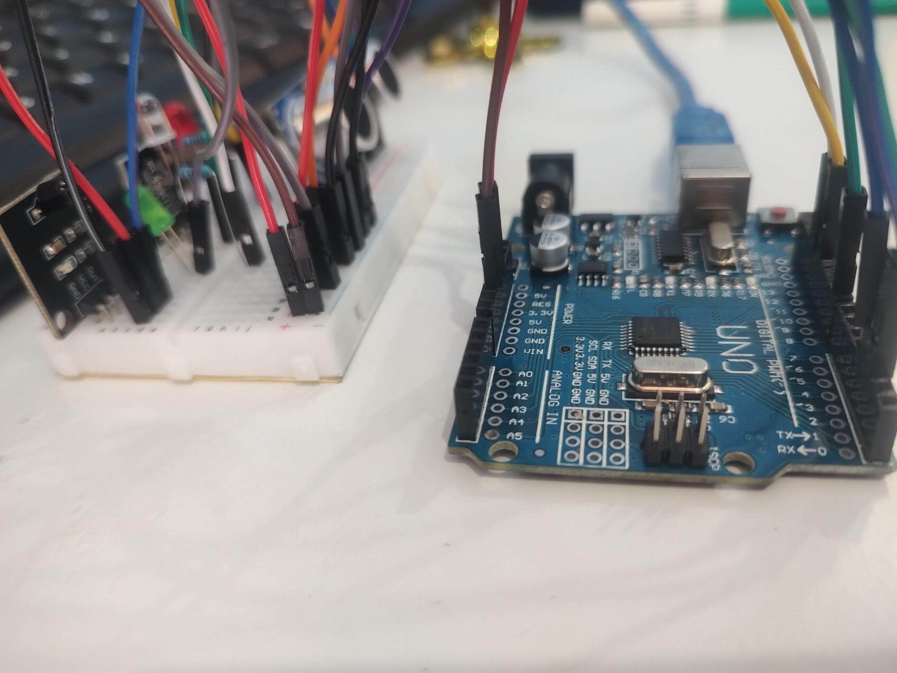
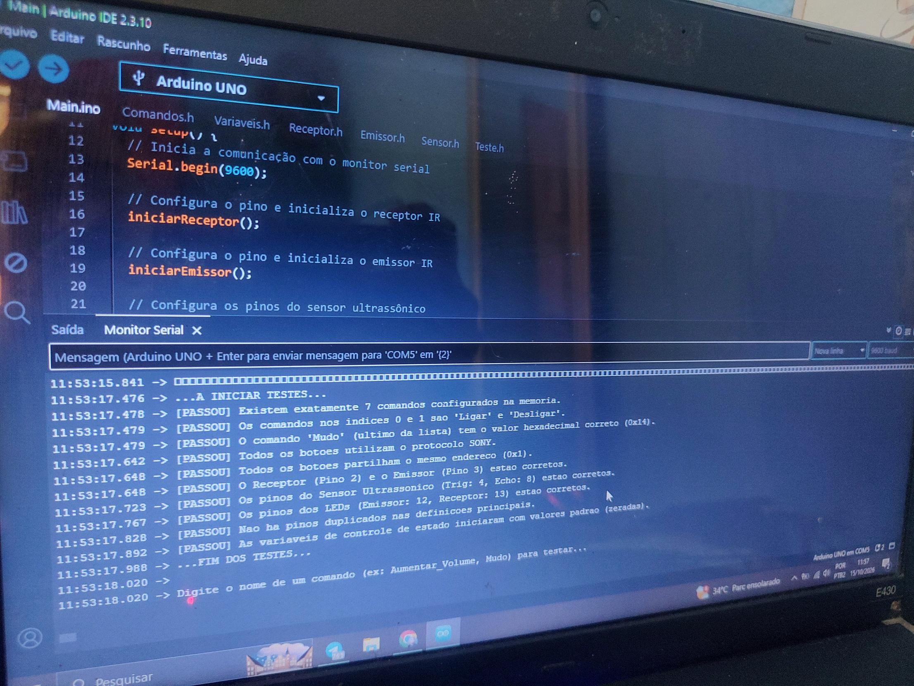

# Controle Remoto Arduino Uno

Controle remoto infravermelho feito com Arduino Uno. Ele captura os códigos IR de um controle de TV, reenvia os comandos pelo emissor e liga/desliga a TV por gesto, usando um sensor ultrassônico.

> Validado somente no hardware físico. Este projeto não tem versão de simulador, porque o Wokwi e o Tinkercad não têm receptor e emissor IR iguais aos usados aqui.

## O que ele faz

1. Captura (receptor IR): lê o sinal do controle original e mostra no monitor serial o protocolo, o endereço e o comando em hexadecimal. O LED verde pisca a cada sinal recebido.
2. Envio por texto (emissor IR): ao digitar o nome de um botão no monitor serial (ex: Volume+, Mudo), o Arduino dispara o sinal IR correspondente. O LED vermelho acende durante o envio.
3. Gesto (sensor ultrassônico): se uma mão ficar entre 5 e 10 cm do sensor, o Arduino envia o comando de ligar/desligar a TV. Há um intervalo mínimo de 10 segundos entre um acionamento e outro.
4. Autotestes: na inicialização, 10 verificações automáticas conferem a lista de comandos, os pinos e o estado inicial das variáveis, e exibem [PASSOU] ou [FALHOU] no monitor serial.

## Comandos cadastrados

Todos usam o protocolo SONY e o endereço 0x1.

| Nome | Comando (hex) |
|---|---|
| Ligar | 0x15 |
| Desligar | 0x15 |
| Volume+ | 0x12 |
| Volume- | 0x13 |
| Canal+ | 0x10 |
| Canal- | 0x11 |
| Mudo | 0x14 |

"Ligar" e "Desligar" têm o mesmo código porque o botão de energia da TV funciona como liga/desliga (toggle).

## Componentes

- 1x Arduino Uno
- 1x Protoboard
- 1x Módulo receptor IR
- 1x Módulo emissor IR
- 1x Sensor ultrassônico HC-SR04
- 1x LED verde (indica recepção)
- 1x LED vermelho (indica envio)
- 2x Resistores de 220 Ω (um para cada LED)
- Jumpers

## Ligações

| Componente | Pino do Arduino |
|---|---|
| Receptor IR | 2 |
| Emissor IR | 3 |
| HC-SR04 Trig | 4 |
| HC-SR04 Echo | 8 |
| LED vermelho (emissor), com resistor de 220 Ω | 12 |
| LED verde (receptor), com resistor de 220 Ω | 13 |

Alimentação em 5 V e GND em comum. O HC-SR04 funciona em 5 V no Uno, então o Echo não precisa de divisor de tensão.

## Estrutura do código

| Arquivo | Função |
|---|---|
| Main.ino | Setup e loop principal |
| Comandos.h | Struct Comando e a lista de botões |
| Variaveis.h | Pinos e variáveis globais |
| Receptor.h | Leitura e decodificação dos sinais IR |
| Emissor.h | Envio dos comandos pelo nome |
| Sensor.h | Leitura de distância e gatilho do gesto |
| Teste.h | Autotestes de inicialização |

## Como usar

1. Instale a biblioteca IRremote na Arduino IDE.
2. Monte o circuito conforme a tabela de ligações.
3. Abra a pasta Main na Arduino IDE, selecione Arduino Uno e envie o código.
4. Abra o monitor serial em 9600 baud.
5. Confira os autotestes e aponte um controle para o receptor para ver o código capturado.
6. Digite o nome de um botão (ex: Mudo) para enviar o sinal, ou aproxime a mão do sensor para ligar/desligar a TV.

## Fotos do projeto

